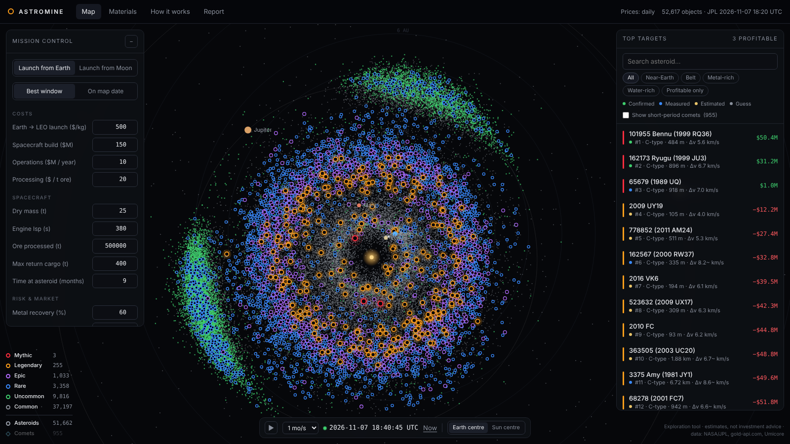

# Astromine — which asteroids are worth mining?

**Live:** https://astromine.live/ · **Monthly-style report (auto-updated):** https://astromine.live/report/



An interactive map of 50,000+ real asteroids and comets from Venus to Saturn, ranked **Common → Uncommon → Rare → Epic → Legendary → Mythic** by expected profit per mining mission. Plug in your own launch costs, spacecraft and risk, launch from Earth or the Moon, and watch the whole solar system re-rank.

## What's real
| | Source | Refresh |
|---|---|---|
| Orbits, sizes, spectral types, radar measurements | NASA/JPL Small-Body Database | hourly |
| Optimised round-trip Δv for ~6,000 near-Earth asteroids | NASA/JPL NHATS | hourly |
| Earth close approaches | NASA/JPL Close-Approach Data | hourly |
| Au, Ag, Pt, Pd, Cu prices | gold-api.com | every minute in the browser |
| Rh, Ir, Ru prices | Umicore | hourly check (published daily) |
| Exact launch windows | Lambert solver, in the browser | when you open an object |

Positions are recomputed every second from Keplerian elements.

## What's estimated
Composition comes from asteroid type → meteorite analogues (only Ryugu, Bennu, Itokawa, Eros, Vesta and Psyche have been visited). Every object carries a data-quality badge: **Confirmed**, **Measured**, **Estimated** or **Guess**. Sizes from brightness can be off by ×2. This is an exploration tool, not investment advice.

## How it runs
Static site on GitHub Pages. A GitHub Action (`.github/workflows/update-data.yml`) runs `scripts/fetch-data.mjs`, `scripts/lambert-batch.mjs` and `scripts/report.mjs` every hour and deploys the site with fresh data straight to GitHub Pages — data is not committed, so the repo stays small. No servers, no API keys.

```
node scripts/fetch-data.mjs && node scripts/lambert-batch.mjs && node scripts/report.mjs   # Node 20+
python3 -m http.server
```

## Licence
MIT
